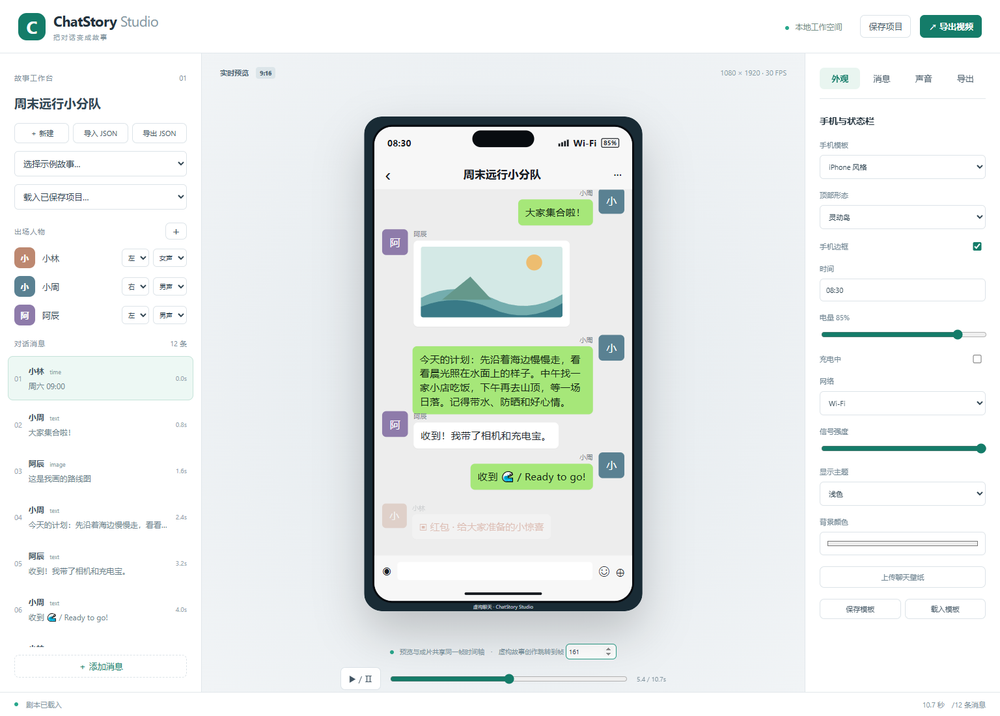

# ChatStory Studio

开源手机聊天故事视频生成器。原创聊天界面、帧时间轴、人物配音与本地批量 MP4 渲染。当前为 **v0.1.0 预发布**。[GitHub 仓库](https://github.com/hubooooo/chatstory-studio) · [下载与演示视频](https://github.com/hubooooo/chatstory-studio/releases/tag/v0.1.0) · [English](README_EN.md)



本项目不隶属于微信、腾讯、Apple 或其他聊天软件官方。所有示例均为虚构故事，输出默认标明“虚构聊天”。请勿将创作内容冒充真实聊天证据。

## 已验证能力

- 中文三栏编辑器：创建、保存、重载、JSON 导入导出、角色昵称／头像／方向／声线、消息增删和排序。
- iPhone／Android 风格、边框、灵动岛／刘海、时间、电量、充电、网络、信号、浅深色、壁纸和本地外观模板。
- 文字、图片、表情、语音、时间、系统通知及模拟红包／转账／名片／撤回提示。财务类元素仅是视觉模拟，不产生真实交易。
- Remotion Player 与 MP4 共用同一组件和帧时间轴；逐条出现、淡入缩放、输入中提示、平滑滚屏和语音波形。
- Edge-TTS 独立程序适配、Windows 离线语音回退、本地录音和缓存。语音秒数由 FFprobe 实测。
- 原创合成提示音、音量／静音、最终混音限幅、队列进度／日志、失败重试、批量失败隔离。
- H.264 + AAC，1080×1920，30 FPS；输出原始／准备后 JSON、校验报告、缩略图、SRT 和 MP4。

## Windows 快速开始

需要 Windows 10/11、Node.js **22 或 24 LTS**、npm 和可联网的首次安装环境。建议至少 8 GB RAM。FFmpeg／FFprobe 由 npm 依赖提供，无需修改 PATH。首次渲染会下载 Remotion Chrome Headless Shell；离线前先完成一次渲染。可以通过 `CHROME_PATH` 指向已安装浏览器。

```powershell
npm ci
npm run dev
```

访问 http://127.0.0.1:3210，或双击 `start-windows.cmd`。若端口占用，设置 `$env:PORT='3211'` 后启动。不要只启动 `npm run web`：它不提供保存、配音或导出接口。

首次打开即可编辑默认故事，也可从左侧选择三个示例。右侧“消息”编辑选中项，“声音”生成／检查语音，“导出”查看任务。底部可播放、暂停和按帧跳转。保存项目位于 `data/`；上传与缓存位于 `public/assets/`。这些内容只在本机处理，Edge 在线配音会向微软服务发送待配音文本。没有遥测、登录、充值或付费接口调用。

## JSON 与命令行

完整契约见 `src/schema/story.schema.json`，可直接从 `examples/demo-a.json` 开始修改。资源路径相对于 `public/`，例如 `assets/photo.png`，不接受绝对路径、远程 URL 或 `..`。

```powershell
npm run render -- --input examples/demo-a.json --output outputs/demo-a.mp4
npm run batch -- --input-dir examples --output-dir outputs
npm run tts -- --input examples/demo-b.json
```

`appear_at_ms` 加开始留白和 `wait_before_ms` 后转换为 30 FPS 帧号。相同时间按 JSON 顺序稳定排列。语音不自动推迟后续消息；请给较长配音留足时间。`voice_mode: manual` 表示只允许在编辑器点按试听，导出中不会自动播放该条语音。单条失败的批处理返回非零退出码，但仍保留其他成片和 `batch-results.json`。

## 配音

示例 B 已带真实 Edge 中文男女声 MP3 缓存，断网仍能渲染。重新生成在线配音需要独立安装 Python 3.10+ 和 [edge-tts](https://github.com/rany2/edge-tts)：

```powershell
python -m venv .venv
.venv\Scripts\python -m pip install edge-tts==7.3.1
```

程序自动查找本项目 `.venv` 或 PATH，也可设置 `EDGE_TTS_PATH`。网络超时会明确报错；可在消息面板导入 WAV／MP3／M4A／OGG。在界面修改人物声线、语速或后端时，会自动清除对应合成音频引用，随后点击生成即可。本地录音不会因更改声线被替换。直接编辑 JSON 时，保留的 `audio_path` 被视为固定录音；如要重生成，应清除该字段和 `audio_duration_ms`。

离线合成可在声音面板选择 Windows 后端：需 PowerShell 7 和安装好的中文 SAPI 声音（女声慧慧、男声康康等）；未安装某个性别的声线会提示错误。离线引擎的自然度与 Edge 神经语音不同，不伪称同一服务。通过 `voice_settings.rate` 控制语速，通过消息时间安排停顿。

## Demo 与验收

真实成片：[文字聊天](https://github.com/hubooooo/chatstory-studio/releases/download/v0.1.0/demo-a.mp4) · [文字＋男女配音](https://github.com/hubooooo/chatstory-studio/releases/download/v0.1.0/demo-b.mp4) · [群聊／图片／长文字](https://github.com/hubooooo/chatstory-studio/releases/download/v0.1.0/demo-c.mp4)。视频作为 Release 附件发布，JSON、字幕、缩略图、日志及校验结果一并提供；用户自己的生成视频仍默认不提交到 Git。

```powershell
npm test
npm run check
npm run lint
npm run build
# 保持 npm run dev 运行后：
npm run test:ui
npx tsx tests/visual.ts
# 已生成三个成片后：
npx tsx tests/media-integration.ts
```

验收与实际限制见 `docs/FINAL_REPORT.md`、`docs/RENDER_QA_REPORT.md`。队列重启后未完成项标记失败，可重新渲染；不支持从中间帧续算。红包／转账／名片采用简化原创视觉。撤回目前是提示消息，不会指定并删除历史气泡。超长单条消息高于整个屏幕时不保证完整展示；请拆成多条。

## 常见问题

- 缺少媒体工具：重新 `npm ci`；企业网络若阻断二进制下载，可设置 `FFMPEG_PATH`／`FFPROBE_PATH` 指向可信本地程序。不要随意下载来历不明的二进制。
- 首次渲染下载失败：检查网络或设置 `CHROME_PATH`。已缓存浏览器和音频后，核心编辑／渲染不需要原站服务。
- 导入 JSON 失败：错误会指出字段路径；检查发送者、唯一 ID、资源路径和固定输出格式。
- 图片／音频缺失：把资源放入 `public/`，JSON 内使用相对路径；移动项目时一并携带资源。
- Windows 路径带空格或中文：命令中的输入输出路径使用引号。
- 声音不可听：检查全局静音、人物音量、自动／手动模式；浏览器首次播放需要用户点击播放按钮。

## 许可证与来源

本项目自身新增源码采用 MIT。**依赖并非全部 MIT，也不保证所有规模企业都能免费使用**。Remotion 使用其自定义许可证：个人、小型营利组织（不超过 3 名员工）等符合条件者可免费用，其他组织可能需要向 Remotion 购买许可；本项目不代购也不绕过限制。FFmpeg 二进制有独立 GPL/LGPL 义务，Edge 服务及 Windows 语音受各自条款约束。详见 `THIRD_PARTY_NOTICES.md` 和 `docs/LICENSE_AUDIT.md`。

感谢 [wechat-dialog-generator](https://github.com/gaopengbin/wechat-dialog-generator) 与 [fake-chat](https://github.com/AmirPhenomenal/fake-chat) 提供产品／技术参考。两者审计时均缺失实际许可证文件，故没有复制其源码或资产；具体 Commit 和检查记录见 `docs/UPSTREAM_ATTRIBUTION.md`。

## 路线图（尚未实现）

- v1.1：更多聊天主题与可扩展模板。
- v1.2：更丰富的语音、动画、指向历史消息的撤回和超长气泡布局。
- v1.3：AI 剧本自动生成。
- v1.4：模板市场、队列管理和批量生产增强。

贡献流程见 `CONTRIBUTING.md`，安全反馈见 `SECURITY.md`。稳定版 v1.0.0 需独立干净机器验收和所有发布阻断项关闭后再评估。
