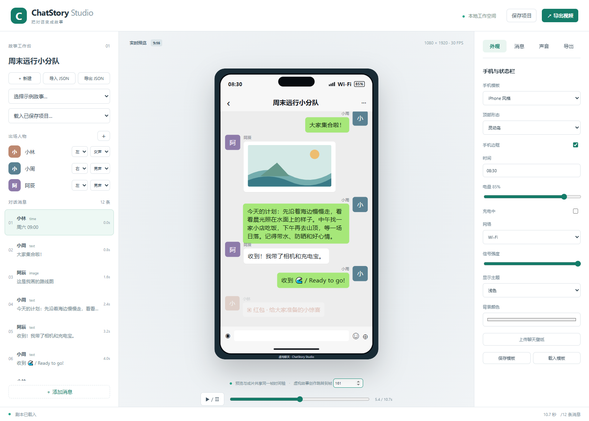

# ChatStory Studio

Local chat story video generator with customizable phone interfaces, animated conversations, AI voices and batch MP4 rendering. **v0.1.0 prerelease.** [Repository](https://github.com/hubooooo/chatstory-studio) · [Downloads and demo videos](https://github.com/hubooooo/chatstory-studio/releases/tag/v0.1.0) · [中文](README.md)



Original React UI, a shared Remotion Player/render timeline, JSON validation, local project saving, media upload, Edge-TTS integration, Windows offline speech, original synthesized effects, queue retry and isolated batch failures. Output: 1080×1920, 30 FPS, H.264/AAC MP4, JSON, logs, probe results, thumbnail and SRT.

## Windows setup

Install Node 22/24 LTS, then `npm ci` and `npm run dev`. Open http://127.0.0.1:3210 or use `start-windows.cmd`. Set `PORT` if occupied. FFmpeg/FFprobe are installed as dependencies; the first render downloads Chrome Headless Shell. `CHROME_PATH`, `FFMPEG_PATH` and `FFPROBE_PATH` can select trusted existing binaries.

```powershell
npm run render -- --input examples/demo-a.json --output outputs/demo-a.mp4
npm run batch -- --input-dir examples --output-dir outputs
npm run tts -- --input examples/demo-b.json
npm test
npm run lint
npm run build
```

Select a bundled example in the left panel. Edit people/messages, configure appearance or audio on the right, play or seek below the phone, save locally, and export. Projects are in `data/`; media are relative to `public/`. Schema: `src/schema/story.schema.json`. Remote URLs, absolute media paths and traversal paths are rejected. Batch continues after invalid inputs and returns a nonzero status if any item fails.

Example B includes cached, genuinely generated Chinese male/female Edge voices. To regenerate, install Python and `edge-tts==7.3.1` in `.venv` or set `EDGE_TTS_PATH`. The independent CLI adapter avoids bundling speech-service code. Network failure does not prevent editing or local audio use. Windows offline speech additionally needs PowerShell 7 and installed Chinese SAPI voices. UI voice/rate/backend changes invalidate generated audio references automatically. When editing JSON directly, clear generated `audio_path`/`audio_duration_ms` to request synthesis again. TTS seconds are measured with FFprobe, never estimated from text length. Online synthesis sends the speech text to Microsoft's service; no telemetry or upstream accounts are required.

Playback and export share the same frame-based UI. `voice_mode: manual` disables automatic voice playback in output. Message times are explicit; long speech does not shift later events. Restarted queue jobs can be retried from the beginning, not resumed mid-frame. Financial/contact bubbles are simplified original simulations. Recall currently renders a notice rather than removing an earlier targeted bubble. Split individual messages taller than the viewport.

The three actual demo videos remain in `outputs/` after rendering and are excluded from Git by default. See `docs/FINAL_REPORT.md`, `docs/RENDER_QA_REPORT.md` and `docs/PERFORMANCE_REPORT.md` for measured results and limitations.

Our original source is MIT. **Remotion has a custom license with eligibility and company licensing requirements**; it is not MIT. FFmpeg/FFprobe binaries and speech engines have independent terms. Read `THIRD_PARTY_NOTICES.md` and `docs/LICENSE_AUDIT.md` before redistribution or organizational use. No paid service is called by this project.

Thanks to [wechat-dialog-generator](https://github.com/gaopengbin/wechat-dialog-generator) and [fake-chat](https://github.com/AmirPhenomenal/fake-chat) for design/technical reference. Actual license files were absent at audited commits; none of their source or assets was copied. Attribution and commit records are preserved in `docs/UPSTREAM_ATTRIBUTION.md`.

Not affiliated with Tencent, WeChat, Apple or other messaging vendors. Examples are fictional and marked as such; do not present generated conversations as real evidence. Roadmap: more themes, richer voice/animation, AI scripting and batch/template improvements. See the Chinese README for complete setup, troubleshooting and planned versions. Contributions: `CONTRIBUTING.md`; security: `SECURITY.md`.
